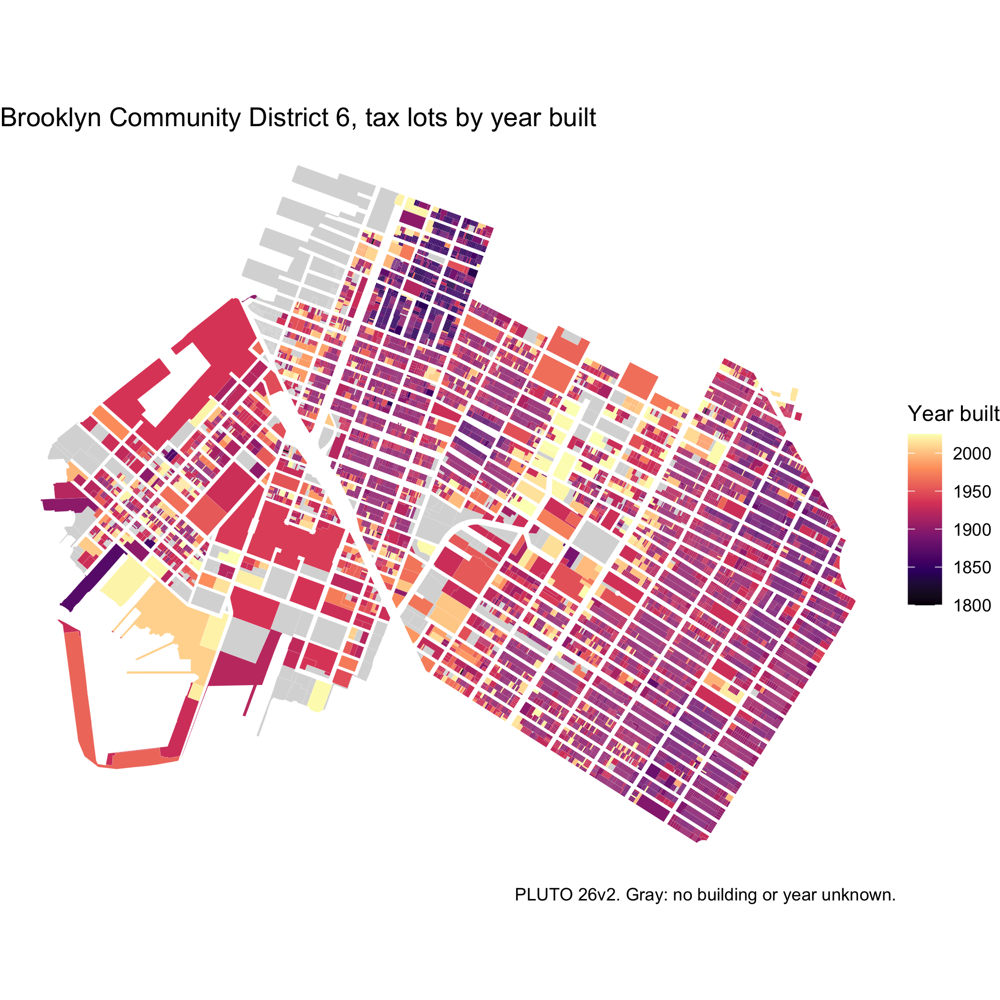

<!-- README.md is generated from README.Rmd. Please edit that file -->

# nycpluto 

<!-- badges: start -->

[](https://github.com/kjhealy/nycpluto/actions/workflows/R-CMD-check.yaml)
<!-- badges: end -->

The nycpluto package provides the New York City Department of City
Planning’s Primary Land Use Tax Lot Output (PLUTO), release 26v2 (August
2026). There is one record for each of the city’s 858,284 tax lots, with
97 fields covering land use, buildings, zoning, ownership, and assessed
value, plus the lot polygon from MapPLUTO. The data are stored as a
GeoParquet file and accessed via
[duckplyr](https://duckplyr.tidyverse.org), so you query only the rows
and columns you need.

## Installation

You can install the development version of nycpluto from
[GitHub](https://github.com/) with:

``` r
# install.packages("pak")
pak::pak("kjhealy/nycpluto")
```

## Load the package

``` r
library(nycpluto)
library(dplyr)
library(ggplot2)
```

## What’s included

### Tax lots

`nyc_pluto()` returns a duckplyr-backed lazy data frame. Use dplyr verbs
to query it and `collect()` to bring results into R. Column names are
PLUTO’s own field names in lower case.

``` r
nyc_pluto() |>
  select(-geometry)
#> The duckplyr package is configured to fall back to dplyr when it encounters an
#> incompatibility. Fallback events can be collected and uploaded for analysis to
#> guide future development. By default, data will be collected but no data will
#> be uploaded.
#> ℹ Automatic fallback uploading is not controlled and therefore disabled, see
#>   `?duckplyr::fallback()`.
#> ✔ Number of reports ready for upload: 78.
#> → Review with `duckplyr::fallback_review()`, upload with
#>   `duckplyr::fallback_upload()`.
#> ℹ Configure automatic uploading with `duckplyr::fallback_config()`.
#> duckdb is storing downloaded extensions and secrets under ~/.duckdb:
#> ℹ /Users/kjhealy/.duckdb
#> This persists across sessions and is shared with the DuckDB CLI and other clients.
#> ℹ Run duckdb(shared_home = FALSE) to use a temporary directory instead.
#> ℹ See ?duckdb_storage for details and alternatives.
#> # A duckplyr data frame: 97 variables
#>    borough block   lot    cd bct2020 bctcb2020  ct2010 cb2010 schooldist council
#>    <chr>   <int> <int> <int> <chr>   <chr>      <chr>  <chr>  <chr>        <int>
#>  1 MN          1    10   101 1000500 100050000… 5      1000   02               1
#>  2 MN          1   100   101 1000500 100050000… 5      0002   <NA>             1
#>  3 MN          1   101   101 1000100 100010010… 1      1001   02               1
#>  4 MN          1   111   101 1000500 100050010… 5      1000   02               1
#>  5 MN          1   112   101 1000500 100050010… 5      1000   02               1
#>  6 MN          1   150   101 1000500 100050010… 5      1008   02               1
#>  7 MN          1   201   101 1000100 100010010… 1      1000   02               1
#>  8 MN          1   301   101 1031703 103170300… 317.03 0001   <NA>             1
#>  9 MN          1   401   101 1031703 103170300… 317.03 0001   <NA>             1
#> 10 MN          2     1   101 1000900 100090010… 9      1025   02               1
#> # ℹ more rows
#> # ℹ 87 more variables: zipcode <chr>, firecomp <chr>, policeprct <int>,
#> #   healthcenterdistrict <int>, healtharea <int>, sanitboro <chr>,
#> #   sanitdistrict <chr>, sanitsub <chr>, address <chr>, zonedist1 <chr>,
#> #   zonedist2 <chr>, zonedist3 <chr>, zonedist4 <chr>, overlay1 <chr>,
#> #   overlay2 <chr>, spdist1 <chr>, spdist2 <chr>, spdist3 <chr>,
#> #   ltdheight <chr>, splitzone <chr>, bldgclass <chr>, landuse <chr>, …
```

`nyc_pluto_to_sf()` turns collected rows into an sf object, with lot
polygons (the default) or points. `nyc_pluto_path()` gives the path to
the GeoParquet file for use with arrow, DuckDB, or GDAL directly.

### Lookup tables and changes

``` r
nyc_pluto_land_use_df
#> # A tibble: 11 × 3
#>    landuse description                              bldgclasses                 
#>    <chr>   <chr>                                    <chr>                       
#>  1 01      One & Two Family Buildings               A*, B*, Z0                  
#>  2 02      Multi-Family Walk-Up Buildings           C0, C1, C2, C3, C4, C5, C6,…
#>  3 03      Multi-Family Elevator Buildings          D0, D1, D2, D3, D4, D5, D8,…
#>  4 04      Mixed Residential & Commercial Buildings C7, D6, D7, K4, O8, R8, R9,…
#>  5 05      Commercial & Office Buildings            G8, GU, GW, H1, H2, H3, H4,…
#>  6 06      Industrial & Manufacturing               E*, F*, L*, RW              
#>  7 07      Transportation & Utility                 G2, G3, G4, G5, G9, T*, U*,…
#>  8 08      Public Facilities & Institutions         H8, I*, M*, N*, P2, P3, P5,…
#>  9 09      Open Space & Outdoor Recreation          P4, P6, Q*, Z8              
#> 10 10      Parking Facilities                       G0, G1, G6, G7, RG, RP, Z2  
#> 11 11      Vacant Land                              V*

nyc_pluto_bldg_class_df
#> # A tibble: 225 × 4
#>    bldgclass description                                landuse source
#>    <chr>     <chr>                                      <chr>   <chr> 
#>  1 A0        Cape cod                                   01      DOF   
#>  2 A1        Two stories - detached sm or mid           01      DOF   
#>  3 A2        One story - permanent living quarter       01      DOF   
#>  4 A3        Large suburban residence                   01      DOF   
#>  5 A4        City residence one family                  01      DOF   
#>  6 A5        One family attached or semi-detached       01      DOF   
#>  7 A6        Summer cottage                             01      DOF   
#>  8 A7        Mansion type or town house                 01      DOF   
#>  9 A8        Bungalow colony - cooperatively owned land 01      DOF   
#> 10 A9        Miscellaneous one family                   01      DOF   
#> # ℹ 215 more rows

nyc_pluto_changes_df
#> # A tibble: 42,955 × 7
#>    bbl        field     old_value                 new_value  type reason version
#>    <chr>      <chr>     <chr>                     <chr>     <int> <chr>  <chr>  
#>  1 1000010301 lotarea   0                         241719        1 Zero … 26v2   
#>  2 1000010401 lotarea   0                         246896        1 Zero … 26v2   
#>  3 1000020001 ownername NYC DSBS                  NYC DEPA…     1 Norma… 19v2   
#>  4 1000020003 ownername NYC DSBS                  NYC DEPA…     1 Norma… 19v2   
#>  5 1000020023 ownername NYC DSBS                  NYC DEPA…     1 Norma… 19v2   
#>  6 1000030001 ownername NYC PARKS DEPT            NYC DEPA…     1 Norma… 22v3   
#>  7 1000030002 ownername NYC PARKS DEPT            NYC DEPA…     1 Norma… 22v3   
#>  8 1000030003 ownername NYC PARKS DEPT            NYC DEPA…     1 Norma… 22v3   
#>  9 1000060001 ownername PARKS AND RECREATION (GE… NYC DEPA…     1 Norma… 19v2   
#> 10 1000070027 yearbuilt 1900                      1828          2 LPC y… 20v1   
#> # ℹ 42,945 more rows
```

## Example: land use by borough

``` r
nyc_pluto() |>
  summarise(
    lots = n(),
    lot_area = sum(lotarea, na.rm = TRUE),
    .by = c(borough, landuse)
  ) |>
  collect() |>
  left_join(nyc_pluto_land_use_df, by = "landuse") |>
  mutate(share = lot_area / sum(lot_area), .by = borough) |>
  filter(landuse %in% c("01", "03", "09", "11")) |>
  select(borough, description, share) |>
  tidyr::pivot_wider(names_from = borough, values_from = share)
#> # A tibble: 4 × 6
#>   description                         QN     BX     BK      SI     MN
#>   <chr>                            <dbl>  <dbl>  <dbl>   <dbl>  <dbl>
#> 1 Vacant Land                     0.0702 0.0633 0.0346 0.162   0.0753
#> 2 Open Space & Outdoor Recreation 0.180  0.305  0.288  0.216   0.225 
#> 3 One & Two Family Buildings      0.341  0.165  0.221  0.339   0.0148
#> 4 Multi-Family Elevator Buildings 0.0376 0.0815 0.0583 0.00825 0.146
```

## Example: a map of lots

Lots in Brooklyn Community District 6 (Park Slope, Carroll Gardens, Red
Hook), by year built.

``` r
library(sf)

bk6 <- nyc_pluto() |>
  filter(cd == 306L) |>
  select(bbl, yearbuilt, landuse, geometry) |>
  collect() |>
  nyc_pluto_to_sf()

bk6 |>
  mutate(yearbuilt = na_if(yearbuilt, 0L)) |>
  ggplot() +
  geom_sf(aes(fill = yearbuilt), color = "white", linewidth = 0.02) +
  scale_fill_viridis_c(option = "magma", na.value = "gray85") +
  labs(
    fill = "Year built",
    title = "Brooklyn Community District 6, tax lots by year built",
    caption = "PLUTO 26v2. Gray: no building or year unknown."
  ) +
  theme_void()
```



## Data sources

- NYC Department of City Planning, [PLUTO and
  MapPLUTO](https://www.nyc.gov/content/planning/pages/resources/datasets/mappluto-pluto-change),
  release 26v2. MapPLUTO is the shoreline-clipped file geodatabase.
- NYC Open Data, [PLUTO](https://data.cityofnewyork.us/d/64uk-42ks), for
  the 1,597 lots not in the clipped MapPLUTO, and the [PLUTO Change
  File](https://data.cityofnewyork.us/d/qt5r-nqxp).
- NYC Department of Finance, building class descriptions from the
  [Annualized Calendar Sales
  Update](https://data.cityofnewyork.us/d/w2pb-icbu) data dictionary.
